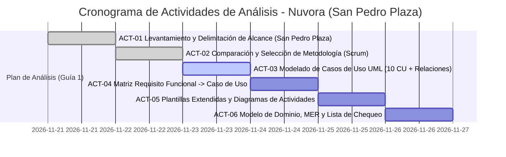

# 03. Plan de Actividades de Análisis y Cronograma de Entregables

**Programa de Formación:** Análisis y Desarrollo de Software (ADSO) — Ficha 3413974  
**Centro de Formación:** Centro de la Industria, la Empresa y los Servicios (CIES) — SENA Regional Huila  
**Proyecto Formativo:** Nuvora — Ecosistema Digital de Promociones, Directorio Interactivo y Plazoleta de Comidas para Centros Comerciales (Caso Piloto: San Pedro Plaza, Neiva)  
**Autor:** Edwin Alejandro Esquivel Bahamón (`edwin-esquivel-ADSO`) — Líder Técnico, Backend & Base de Datos  
**Equipo de Desarrollo:** Edwin Esquivel, Jose Covaleda, Paula Claros  
**Instructores de Seguimiento:** Instructora Karol Correa (Técnica y Curricular) · Instructor Jesús Ariel González Bonilla (Planificación y Gestión Ágil)  
**Guía 1:** Modelo Conceptual (Análisis) — **Producto 1:** Plan de Análisis y Casos de Uso (G1-P1)  

---

## 1. Enfoque del Plan de Análisis

Siguiendo la metodología de trabajo acordada (**Scrum con buenas prácticas técnicas de programación**) y las pautas de planificación del **Instructor Jesús Ariel González Bonilla**, la fase de análisis del proyecto **Nuvora** se organiza como un plan de actividades claro, ordenado y medible.

El objetivo principal es tomar las necesidades reales de los locatarios y visitantes del **Centro Comercial San Pedro Plaza** (registradas en el documento de requisitos) y transformarlas en diagramas de Casos de Uso bajo estándar UML y modelos de base de datos normalizados, garantizando que cada función aporte valor al negocio y permita evaluar con éxito los tres resultados de aprendizaje de la guía (RAP 592375, 592373 y 592374).

---

## 2. Matriz de Actividades de Análisis Priorizadas (Rúbrica G1 · Criterio C2)

A continuación se presentan las **6 actividades obligatorias de análisis**, ordenadas por prioridad de desarrollo, indicando el responsable, las fechas de realización, el entregable concreto y el criterio de aceptación:

| # | Actividad de Análisis | Prioridad | Responsable | Fechas de Ejecución | Entregable Verificable | Criterio de Aceptación / Entrega Terminada |
| :---: | :--- | :---: | :--- | :---: | :--- | :--- |
| **ACT-01** | **Levantamiento de Información y Alcance (Estudio San Pedro Plaza)** | **Alta** | Paula Claros *(Análisis y Diseño)* / Edwin Esquivel | 21/Nov/2026 al 22/Nov/2026 | Documento formal de requisitos con informe de encuestas en Neiva (35 encuestas y 6 entrevistas), 20 Requisitos Funcionales y 10 No Funcionales. | Alcance delimitado y claro; exclusión justificada de domicilios y pagos en línea aprobada con la Instructora Karol Correa. |
| **ACT-02** | **Comparación y Selección de la Metodología de Desarrollo** | **Alta** | Edwin Esquivel *(Líder Técnico)* | 22/Nov/2026 al 23/Nov/2026 | Documento comparativo formal (Scrum vs RUP vs XP vs RAD) evaluado bajo las características del proyecto. | Selección y justificación del marco Scrum adaptado con prácticas de ingeniería; división clara de roles entre los 3 aprendices. |
| **ACT-03** | **Modelado de Casos de Uso del Sistema Nuvora (UML)** | **Crítica** | Edwin Esquivel *(Modelado UML y Backend)* | 23/Nov/2026 al 24/Nov/2026 | Diagrama de Casos de Uso en archivo editable de Draw.io (`.drawio`) e imagen vectorial (`.svg`) con la frontera del sistema. | Mínimo 8 casos de uso (10 modelados) con nombres en formato `[Verbo] + [Objeto]`, 4 actores fuera de la frontera, relaciones `«include»` y `«extend»` explicadas y sin cruces. |
| **ACT-04** | **Construcción de la Matriz de Requisitos a Casos de Uso** | **Alta** | Edwin Esquivel *(Líder Técnico)* | 24/Nov/2026 al 25/Nov/2026 | Matriz de trazabilidad en documento Markdown estructurado. | Cobertura del 100% (20 de 20 Requisitos Funcionales) relacionados con al menos un Caso de Uso; diferenciación clara de requisitos no funcionales. |
| **ACT-05** | **Detalle de Flujos Principales (Plantillas Extendidas y Actividades)** | **Alta** | Jose Covaleda *(Frontend)* / Edwin Esquivel | 25/Nov/2026 al 26/Nov/2026 | 3 Plantillas extendidas de casos de uso y 2 Diagramas de Actividades con carriles por actor y decisiones con condiciones `[ ]`. | Flujo de canje en caja y flujo de creación de ofertas relámpago explicados paso a paso con alternativas y excepciones en lenguaje de negocio. |
| **ACT-06** | **Modelo de Dominio, Modelo Entidad-Relación (MER) y Chequeo** | **Crítica** | Edwin Esquivel *(Base de Datos)* | 26/Nov/2026 al 27/Nov/2026 | Modelo de Dominio (8 clases conceptuales), MER (11 tablas en PostgreSQL con relación muchos a muchos resuelta) y Lista de Chequeo de 15 criterios. | Base de datos con llaves primarias y foráneas coherentes; lista de chequeo diligenciada con registro de 5 ajustes verificados. |

---

## 3. Cronograma Visual de Ejecución (Diagrama de Gantt)

---

## 4. Matriz Inicial de Riesgos y Acciones de Mitigación

Para prevenir problemas técnicos y asegurar una calificación sobresaliente en la evaluación, definimos los siguientes controles:

| Riesgo Identificado | Severidad | Probabilidad | Acción de Control en el Análisis y Diseño |
| :--- | :---: | :---: | :--- |
| **R1: Que alguien intente usar un cupón dos veces con capturas de pantalla** | Alta | Media | Regla de negocio **RN-04**: bloqueo inmediato del cupón en la base de datos al momento del canje y código aleatorio único que expira en 2 horas. |
| **R2: Que cambien la hora del celular para reclamar ofertas fuera de horario** | Alta | Media | Regla de negocio **RN-05**: la validez de las promociones relámpago se comprueba exclusivamente contra la hora oficial del servidor, no del teléfono. |
| **R3: Filas y demoras en caja por lentitud al escanear** | Alta | Baja | Requisito **RNF01**: pantalla sencilla para el cajero con lector de cámara y teclado numérico con respuesta en menos de 1.5 segundos. |
| **R4: Penalización en la rúbrica por subir todo en un solo día (Tope 70)** | Crítica | Baja | Programación de commits en **al menos 2 días calendario distintos** (Martes 24/Nov y Jueves 26/Nov) antes del sábado 28 a las 6:00 a.m. |
| **R5: Dudas en las preguntas orales de sustentación (Tope 50)** | Crítica | Baja | Justificación en una línea de cada relación `«include»` y `«extend»`, redactadas con palabras propias y claras para sustentar con seguridad. |