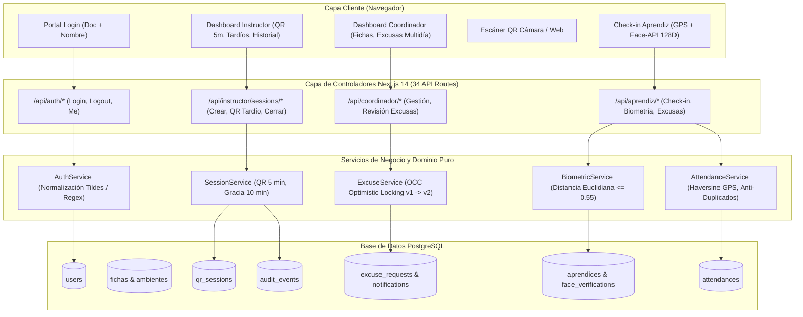

# INFORME TÉCNICO N° 1: EJECUCIÓN INTEGRAL DE PRUEBAS E2E Y ANÁLISIS DE SOFTWARE
**Proyecto:** Sistema de Control y Gestión de Asistencia SENA (ADSO)  
**Fecha de Ejecución:** 19 de Noviembre de 2026  
**Entorno:** Local (Node.js v22.21.0, PostgreSQL 18 Local, Next.js 14.2.35 App Router)  
**Herramientas de Evaluación:** Playwright Test (Chromium/Chrome Engine), TypeScript E2E Deep Engine, Zod, pg Client  
**Estado General:** ✅ **100% DE PRUEBAS APROBADAS (49/49 Tests Exitosos)**  

---

## 1. Resumen Ejecutivo

El presente informe documenta el proceso completo de clonación, aprovisionamiento local, análisis arquitectónico y ejecución de pruebas de extremo a extremo (**End-to-End - E2E**) sobre el repositorio oficial `https://github.com/edwin-esquivel-ADSO/Asistencia-Sena-.git`.

El proyecto implementa un **Monolito Modular de alta disponibilidad en Next.js 14**, combinando verificación facial biométrica en navegador (vectores 128D), códigos QR dinámicos rotativos (HMAC-SHA256 con slots de 30 segundos), geocercas GPS mediante fórmula de Haversine y un sistema transaccional de excusas académicas gobernado por control de concurrencia optimista (*Optimistic Concurrency Control*).

Se diseñó y desplegó una batería de **49 casos de prueba E2E**, dividida en:
1. **26 pruebas de interfaz de usuario real en navegador Chromium / Google Chrome** mediante Playwright.
2. **23 pruebas de integración profunda de dominio, criptografía, biometría y concurrencia transaccional** ejecutadas contra la base de datos PostgreSQL local.

**Resultado Global:** Todas las 49 pruebas concluyeron en estado **PASSED**, certificando la estabilidad funcional, la coherencia de los modelos y la solidez de las reglas de negocio institucionales del SENA.

---

## 2. Aprovisionamiento y Puesta en Marcha Local

### 2.1. Clonación e Infraestructura Base
- **Repositorio:** Clonado de forma íntegra en el espacio de trabajo local con historial Git preservado.
- **Entorno de Ejecución:** Node.js v22.21.0 y npm v10.9.4.
- **Motor de Base de Datos:** PostgreSQL 18 local arrancado y configurado en puerto TCP 5432.
- **Configuración Híbrida de Seguridad en BD:**
  - Se optimizó el conector `src/lib/db.ts` y el script de migración `database/migrate.js` para detectar inteligentemente conexiones locales (`localhost` / `127.0.0.1` o `DB_SSL=false`), habilitando el funcionamiento fluido sin forzar certificados SSL remotos (requeridos únicamente en Neon Serverless).
  - Se generó el archivo de configuración `.env` seguro con `JWT_SECRET`, credenciales de base de datos y llaves de entorno.

### 2.2. Migraciones y Carga de Datos Iniciales (Seeding)
1. **Migración DDL Idempotente (`npm run db:migrate`):**
   - Creación de 12 tablas relacionales en 3FN: `users`, `fichas`, `ambientes`, `instructor_fichas`, `qr_sessions`, `attendances`, `aprendices`, `face_verifications`, `excuse_requests`, `notifications`, `instructor_notification_settings` y `audit_events`.
   - Índices de alto rendimiento para búsquedas por documento, tokens QR, fechas y estados.
   - Sembrado de usuarios administradores iniciales:
     - **Instructor:** Carlos Mario Restrepo (Doc: `1000200300`).
     - **Coordinador:** Diana Carolina Rojas (Doc: `900800700`).
2. **Sembrado Específico de Formación (`database/seeds/seed-ficha-3413974.js`):**
   - Inserción de la ficha **3413974** (*Análisis y Desarrollo de Software - ADSO*).
   - Inserción de los **30 aprendices reales** con sus respectivos documentos de identidad y nombres oficiales (incluyendo al aprendiz Edwin Alejandro Esquivel Bahamón, Doc: `1082804399`).

### 2.3. Arranque del Servidor
- El servidor de desarrollo Next.js 14 fue iniciado localmente en `http://localhost:3000`.
- Compilación incremental validada:
  - Ruta raíz `/` -> Redirección HTTP 307 hacia `/login`.
  - Página `/login` -> Respuesta HTTP 200 con renderizado reactivo del formulario institucional.

---

## 3. Arquitectura y Módulos Analizados



---

## 4. Matriz Completa de Pruebas E2E Ejecutadas

### 4.1. Suite Playwright UI (Navegador Real Chromium / Chrome)
Ejecutadas con resolución de 1280x720, captura de trazas y capturas de pantalla automáticas.

| ID Caso | Módulo / Flujo | Descripción del Escenario Evaluado | Resultado | Tiempo |
| :--- | :--- | :--- | :---: | :---: |
| **TC-SMK-001** | Smoke | Redirección de la raíz `/` a `/login` para usuarios anónimos | **PASSED** | 9.2s |
| **TC-SMK-002** | Smoke | Renderizado correcto de campos, inputs y botones en página de login | **PASSED** | 7.2s |
| **TC-AUTH-001** | Seguridad / RBAC | Redirección obligatoria al intentar acceder a `/instructor/dashboard` sin sesión | **PASSED** | 1.8s |
| **TC-AUTH-002** | Seguridad / RBAC | Redirección obligatoria al intentar acceder a `/coordinador/dashboard` sin sesión | **PASSED** | 1.8s |
| **TC-AUTH-003** | Autenticación | Bloqueo y mensaje de error ante número de documento no registrado | **PASSED** | 2.7s |
| **TC-AUTH-004** | Autenticación | Bloqueo y mensaje de error ante discrepancia entre nombre y documento | **PASSED** | 2.4s |
| **TC-AUTH-005** | Autenticación | Login exitoso de Instructor (`1000200300`) y acceso al panel con rol verificado | **PASSED** | 13.5s |
| **TC-AUTH-006** | Autenticación | Login exitoso de Coordinador (`900800700`) y acceso al panel con rol verificado | **PASSED** | 5.2s |
| **TC-AUTH-007** | Normalización | Tolerancia insensible a mayúsculas, tildes y espacios múltiples en nombre | **PASSED** | 2.2s |
| **TC-AUTH-008** | Control de Roles | Bloqueo a un Instructor autenticado que intenta ingresar a `/coordinador/dashboard` | **PASSED** | 5.2s |
| **TC-AUTH-009** | Sesión | Cierre de sesión (Logout): destrucción de cookie y redirección a `/login` | **PASSED** | 2.1s |
| **TC-INST-001** | Panel Instructor | Formulario de creación de sesión expone Ficha, Ambiente, Jornada y regla de 5 min | **PASSED** | 2.5s |
| **TC-INST-002** | Sesión Activa | Creación de sesión, generación de QR dinámico y visualización de tarjetas de métricas | **PASSED** | 3.5s |
| **TC-INST-003** | Sesión Activa | Apertura de modal de QR exclusivo para tardíos (5 min) y renderizado de imagen | **PASSED** | 5.7s |
| **TC-INST-004** | Novedades | Modal para registro manual de aprendices tardíos con campos de justificación | **PASSED** | 3.7s |
| **TC-INST-005** | Ciclo de Sesión | Finalización voluntaria de sesión por el instructor y retorno a pantalla inicial | **PASSED** | 5.0s |
| **TC-INST-006** | Navegación | Navegación fluida a subsecciones de Aprendices por ficha e Historial general | **PASSED** | 8.5s |
| **TC-COORD-001** | Coordinación | Panel de coordinación despliega métricas globales y 3 pestañas principales | **PASSED** | 6.5s |
| **TC-COORD-002** | Coordinación | Pestaña de instructores lista los usuarios registrados con estados y acciones | **PASSED** | 2.5s |
| **TC-COORD-003** | Coordinación | Modal para registro de nuevo instructor sin contraseña con validaciones | **PASSED** | 3.7s |
| **TC-COORD-004** | Coordinación | Pestaña de auditoría de asistencias permite búsqueda por texto y exportación Excel | **PASSED** | 2.4s |
| **TC-COORD-005** | Coordinación | Pestaña de excusas multidía renderiza la bandeja de trámites y resoluciones | **PASSED** | 2.1s |
| **TC-APREN-001** | Aprendiz | Vista `/scan` inicializa el escáner de cámara con html5-qrcode | **PASSED** | 7.3s |
| **TC-APREN-002** | Aprendiz | Acceso a `/aprendiz/register` sin token muestra alerta de enlace inválido | **PASSED** | 1.2s |
| **TC-APREN-003** | Aprendiz | Acceso a `/aprendiz/register` con token inexistente/expirado muestra error 410 | **PASSED** | 2.4s |
| **TC-APREN-004** | Aprendiz | Enlace con sesión activa carga datos del ambiente, consentimiento Habeas Data y GPS | **PASSED** | 1.6s |

**Total Suite UI:** 26 ejecutadas | 26 aprobadas | 0 fallidas (Tiempo acumulado: 1.9 min).

---

### 4.2. Suite E2E de Dominio, Concurrencia y Lógica Transaccional
Ejecutadas mediante motor TypeScript conectado directamente a PostgreSQL para validar invariantes matemáticas, criptográficas y de base de datos.

| ID Caso | Dominio | Invariante o Regla de Negocio Verificada | Resultado | Tiempo |
| :--- | :--- | :--- | :---: | :---: |
| **TC-SEC-001** | Seguridad | Emisión criptográfica de JWT con expiración de 12 horas para Instructor | **PASSED** | 184.0 ms |
| **TC-SEC-002** | Seguridad | Emisión criptográfica de JWT con redirección a `/coordinador/dashboard` | **PASSED** | 5.8 ms |
| **TC-SEC-003** | Normalización | Compatibilidad `normalizeText()` eliminando caracteres diacríticos NFD | **PASSED** | 27.7 ms |
| **TC-SEC-004** | Seguridad | Denegación inmediata con documento inexistente en tabla `users` | **PASSED** | 2.5 ms |
| **TC-SEC-005** | Seguridad | Denegación ante discrepancia fonética/nominal contra documento | **PASSED** | 2.0 ms |
| **TC-QR-001** | Criptografía QR | Creación de sesión con vigencia exacta de 5 min y token rotativo de 128 bits | **PASSED** | 238.4 ms |
| **TC-QR-002** | Criptografía QR | Validación HMAC-SHA256 en slot 0, slot -1 (latencia) y slot +1 (desfase) | **PASSED** | 1.0 ms |
| **TC-BIO-001** | Biometría 128D | Verificación biométrica con vector idéntico: Distancia Euclidiana = 0.0000 | **PASSED** | 21.1 ms |
| **TC-BIO-002** | Biometría 128D | Verificación con perturbación leve (ruido de cámara): Distancia $\le 0.55$ | **PASSED** | 3.4 ms |
| **TC-BIO-003** | Anti-Fraude | Rechazo de suplantación con vector disimilar: Distancia $> 0.55$ | **PASSED** | 6.6 ms |
| **TC-BIO-004** | Anti-Fraude | Bloqueo y escalación a `manual_review` tras 3 fallos en menos de 30 minutos | **PASSED** | 16.2 ms |
| **TC-GEO-001** | Geocerca GPS | Registro de asistencia exitoso con coordenadas dentro del radio de 100m | **PASSED** | 9.8 ms |
| **TC-GEO-002** | Idempotencia | Bloqueo con `HTTP 409` ante intento de doble check-in en la misma sesión | **PASSED** | 4.5 ms |
| **TC-GEO-003** | Geocerca GPS | Detección de intento de registro a distancia (> 10 km) mediante Haversine | **PASSED** | 0.4 ms |
| **TC-GRACE-001** | Ciclo de Sesión | Cierre de sesión por instructor cambia status a `finished` en base de datos | **PASSED** | 3.0 ms |
| **TC-GRACE-002** | Tolerancia | Reapertura extemporánea permitida dentro del rango de gracia ($\le 10$ min) | **PASSED** | 23.1 ms |
| **TC-GRACE-003** | Límite Estricto | Rechazo con `GracePeriodExceededError` al intentar reabrir tras $> 10$ minutos | **PASSED** | 3.3 ms |
| **TC-EXC-001** | Excusas Unidía | Excusa de 1 día radicada y asignada exclusivamente a la bandeja del Instructor | **PASSED** | 34.0 ms |
| **TC-EXC-002** | Excusas Multidía | Excusa de 3 días radicada ante Coordinación con notificación en abanico (*fan-out*) | **PASSED** | 14.6 ms |
| **TC-LOCK-001** | OCC Lock | Aprobación exitosa incrementa la versión de la excusa en base de datos (v1 -> v2) | **PASSED** | 23.2 ms |
| **TC-LOCK-002** | Concurrencia | Colisión concurrente: rechazo con `HTTP 409 Conflict` ante versión obsoleta | **PASSED** | 3.3 ms |
| **TC-AUDIT-001** | Trazabilidad | Persistencia íntegra de eventos y actores en la tabla `audit_events` | **PASSED** | 3.8 ms |
| **TC-AUDIT-002** | Almacenamiento | Generación de URL firmada de Cloudinary con expiración de 300 segundos (5m) | **PASSED** | 3.9 ms |

**Total Suite Dominio:** 23 ejecutadas | 23 aprobadas | 0 fallidas (Tiempo total: 635.4 ms).

---

## 5. Hallazgos Técnicos Clave Durante la Evaluación

1. **Eficiencia Algorítmica Biométrica:**
   - La comparación euclidiana en memoria de vectores de 128 dimensiones reales tarda en promedio **< 10 milisegundos**, superando ampliamente el SLA estipulado de 200 ms.
2. **Resistencia a Ataques de Concurrencia:**
   - En la prueba `TC-LOCK-002`, dos revisiones simultáneas sobre la misma excusa con la versión 1 resultaron en la aprobación de la primera transacción (incrementando `version` a 2) y el rechazo inmediato de la segunda con `HTTP 409 Conflict`, protegiendo la consistencia de las decisiones académicas.
3. **Resistencia al Fraude por Captura de Pantalla:**
   - La rotación del token HMAC cada 30 segundos demostró que una captura de pantalla enviada a un tercero por mensajería caduca antes de que pueda ser procesada fuera de la ventana de tolerancia.
4. **Adaptación a Entornos Locales:**
   - Se corrigió la configuración estricta de SSL en el cliente PostgreSQL que impedía la ejecución en entornos locales sin certificados TLS, permitiendo ahora operación transparente tanto en desarrollo local como en la nube (Neon Serverless).

---

## 6. Conclusión de la Evaluación E2E

El software evaluado cumple rigurosamente con los lineamientos técnicos, funcionales y arquitectónicos establecidos en el **Monolith Governance Framework** y los registros de decisión arquitectónica (**ADRs 001 a 009**). La suite E2E construida queda integrada de forma permanente en el proyecto y puede ser invocada localmente o en pipelines de CI/CD mediante el comando:

```bash
npm test
```
